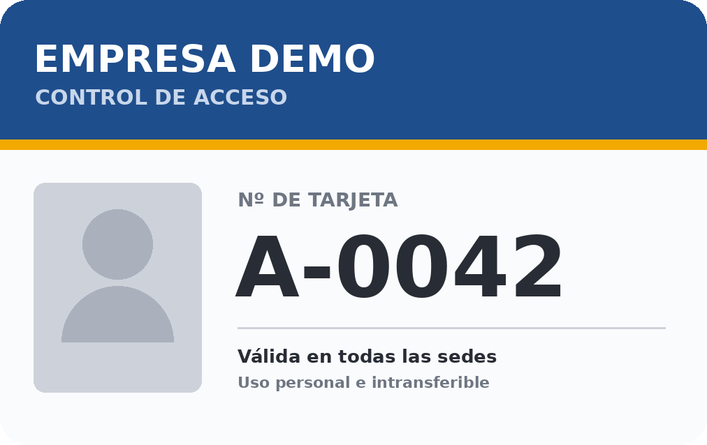
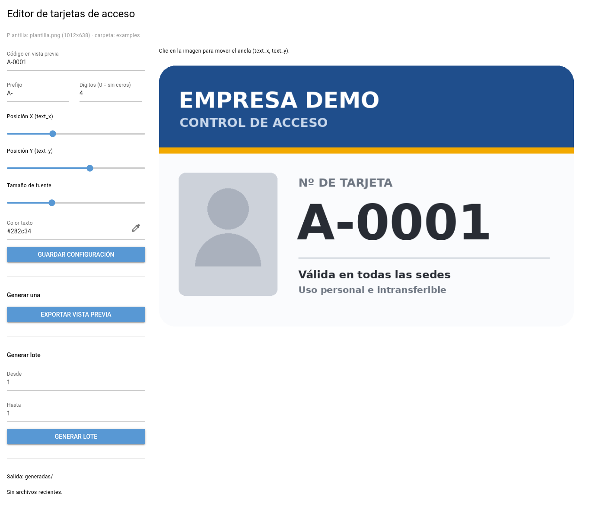

# Editor de tarjetas de control de acceso

[](https://github.com/jualas/editor-tarjetas-acceso/actions/workflows/ci.yml)


Aplicación en Python para diseñar y generar en lote las tarjetas de control de acceso de una empresa: se parte de una plantilla (el diseño de la tarjeta sin número), se coloca el código visualmente y se exportan tantas tarjetas numeradas como hagan falta.



## Funcionalidades

- **Editor visual** (web local con [NiceGUI](https://nicegui.io/)): posición del código con deslizadores o haciendo clic sobre la tarjeta, tamaño y color de la fuente, y vista previa en tiempo real.
- **Formato de código configurable**: prefijo (`A-`, `V`, …) y relleno de ceros (`A-0042`).
- **Generación por lotes** desde la interfaz o desde la línea de comandos.
- **Cualquier plantilla** PNG o JPG; la transparencia (esquinas redondeadas) se aplana sobre blanco.
- **Ejecutable para Windows** con PyInstaller, generable desde Linux con Docker.
- Configuración validada, con mensajes claros cuando un valor no es válido.

## Inicio rápido

Requiere Python 3.11 o superior.

```bash
python3 -m venv .venv
source .venv/bin/activate        # Windows: .venv\Scripts\activate
pip install -r requirements.txt
./run.sh                         # o: python -m tarjeta_editor.app
```

Abre **http://127.0.0.1:8765**. Por defecto usa la plantilla de ejemplo de [`examples/`](examples/).



### Línea de comandos

```bash
python -m tarjeta_editor 42            # una tarjeta  → Tarjeta_A-0042.png
python -m tarjeta_editor 1 250         # lote del 1 al 250
python -m tarjeta_editor A-0010 A-0020 -o salida/
```

## Usar tu propia plantilla

1. Crea una carpeta con el diseño de la tarjeta **sin número** (por ejemplo `plantilla.png`).
2. Apunta la aplicación a ella: `TARJETA_ASSETS_DIR=/ruta/a/la/carpeta ./run.sh`.
3. Coloca el código en el editor y pulsa **Guardar configuración**: se crea `tarjeta_meta.json` en esa carpeta.

`tarjeta_meta.json`:

| Campo | Descripción | Por defecto |
|-------|-------------|-------------|
| `fondo` | Fichero de la plantilla dentro de la carpeta | `plantilla.png` / `plantilla.jpg` |
| `text_x`, `text_y` | Ancla del código: borde izquierdo y centro vertical, en píxeles | `93`, `266` |
| `font_size` | Tamaño de la fuente (8–1000) | `154` |
| `fill` | Color del texto `[R, G, B]` | `[15, 15, 15]` |
| `prefijo` | Texto delante del número (hasta 10 letras, números, `-` o `_`) | `""` |
| `digitos` | Rellena con ceros hasta esta longitud (0 = sin relleno) | `0` |

### Variables de entorno

| Variable | Descripción |
|----------|-------------|
| `TARJETA_ASSETS_DIR` | Carpeta con la plantilla y `tarjeta_meta.json` (por defecto `examples/`; en el `.exe`, la carpeta del ejecutable) |
| `TARJETA_PLANTILLA` | Plantilla concreta; tiene prioridad sobre el campo `fondo` |
| `TARJETA_OUTPUT_DIR` | Carpeta de salida (por defecto `<assets>/generadas`) |
| `TARJETA_EDITOR_PORT` | Puerto de la interfaz (por defecto `8765`) |
| `TARJETA_EDITOR_HOST` | Interfaz de red (por defecto `127.0.0.1`). La aplicación no tiene autenticación: no la expongas fuera de tu equipo |

## Ejecutable para Windows

Desde Linux, con Docker (PyInstaller sobre Wine):

```bash
./scripts/build-win-docker.sh
```

Desde Windows: `.\scripts\build-win.ps1`.

El resultado es `dist/TarjetasAcceso/`. Copia **la carpeta entera** (incluido `_internal\`), pon la plantilla y `tarjeta_meta.json` junto a `TarjetasAcceso.exe` y ejecútalo: se abre el navegador con el editor, y las tarjetas se guardan en `generadas\`.

## Desarrollo

```bash
pip install -r requirements-dev.txt
pytest                 # tests de render, configuración y CLI
ruff check . && ruff format --check .
```

La plantilla de ejemplo se regenera con `python scripts/crear_plantilla_ejemplo.py`.

### Estructura

```
tarjeta_editor/
├── assets.py   # rutas, plantilla y configuración (carga, validación, guardado)
├── render.py   # formato del código y dibujo con Pillow
├── cli.py      # línea de comandos
└── app.py      # interfaz NiceGUI
examples/       # plantilla neutra y su configuración
tests/          # pytest
```

## Licencia

[MIT](LICENSE). La fuente incluida, DejaVu Sans Bold, tiene su propia [licencia libre](https://dejavu-fonts.github.io/License.html).
